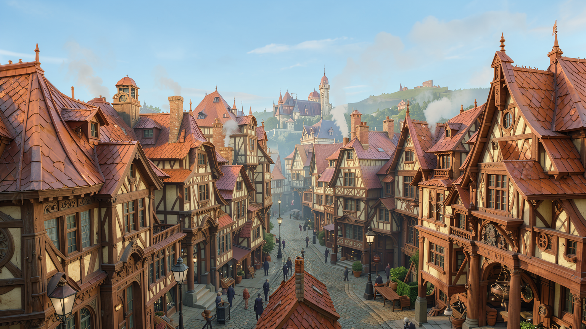

# Colour an image and animate the result locally

This practical ComfyUI example takes our grayscale town, adds colour with a reference-image graph, and animates the chosen colour PNG with LTX. The source, finished images, complete five-second clip and working graphs are included.

**[Download the full example](downloads/COLOUR-AND-MOTION-KIT.zip)** · [Start here](PRACTICE-COLOUR-AND-MOTION/README.md) · [Deutsch](PRACTICE-COLOUR-AND-MOTION/START-DE.md) · [Models and folders](PRACTICE-COLOUR-AND-MOTION/MODEL-FOLDERS.md)

| Action | Open in ComfyUI |
|---|---|
| Colour the reference image | [Colour workflow](PRACTICE-COLOUR-AND-MOTION/workflows/01-COLOUR.workflow.json) |
| Animate the chosen PNG | [Motion workflow](PRACTICE-COLOUR-AND-MOTION/workflows/02-ANIMATE.workflow.json) |
| Save a different motion prompt | [Prompt-saving workflow](PRACTICE-COLOUR-AND-MOTION/workflows/03-SAVE-MOTION-PROMPTS.workflow.json) |

The runner uses separate owned image/video processes and a new output folder. Our recorded example uses an existing Windows ComfyUI installation on64GB Strix Halo. Its actual clip is121 frames at24fps,1280x704, without a soundtrack. The motion conditioning is reused from our already executed town-motion prompt; the colour PNG is new. No model weights or private photographs are bundled.

[Native colour record](PRACTICE-COLOUR-AND-MOTION/NATIVE-COLOUR-VALIDATION.json) · [Native motion record](PRACTICE-COLOUR-AND-MOTION/NATIVE-MOTION-VALIDATION.json) · [Manifest](PRACTICE-COLOUR-AND-MOTION/MANIFEST.json)

## Previous greeting-card and animation packages

[Greeting-card download](downloads/01-grusskarten-v2.zip) · [Animation download](downloads/02-animation-v2.zip) · [Previous guide](README-BEFORE-COLOUR-PRACTICE.md). Earlier files are preserved.

## Deutsch

Das neue Beispiel färbt unsere eigene erzeugte Schwarzweiss-Stadt und animiert genau die gewählte Farb-PNG. Echte Ergebnisse und direkt zu öffnende Graphen liegen im Download. Das Bewegungs-Conditioning stammt aus unserem bereits ausgeführten Gemma-Textlauf. Die Farben sind eine Interpretation, kein historischer Nachweis. Der neue Film ist englisch mit deutschen Untertiteln; menschliches Vollhören/Vollsehen bleibt gesondert offen.
